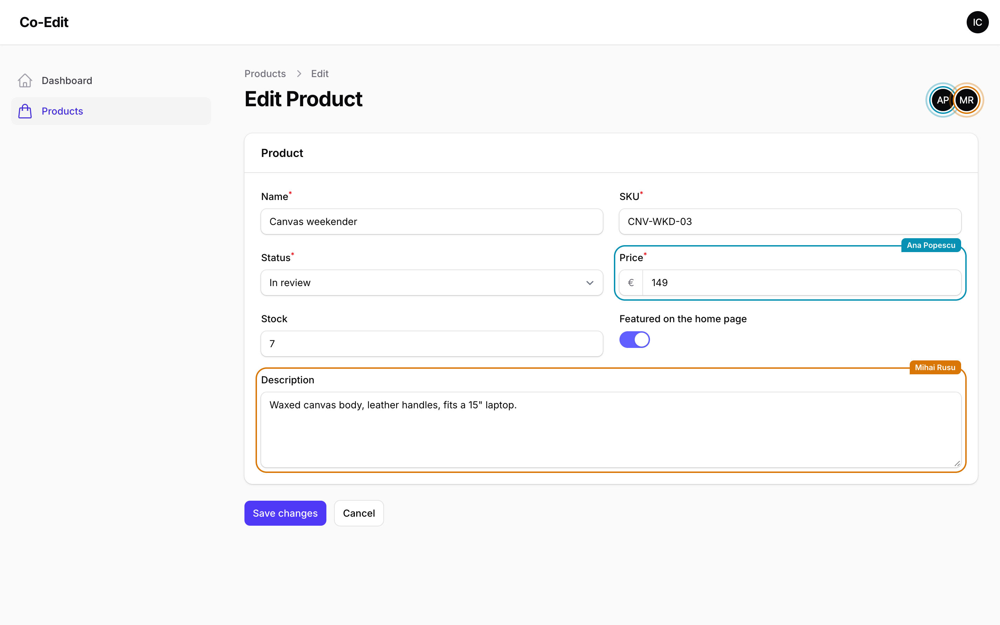
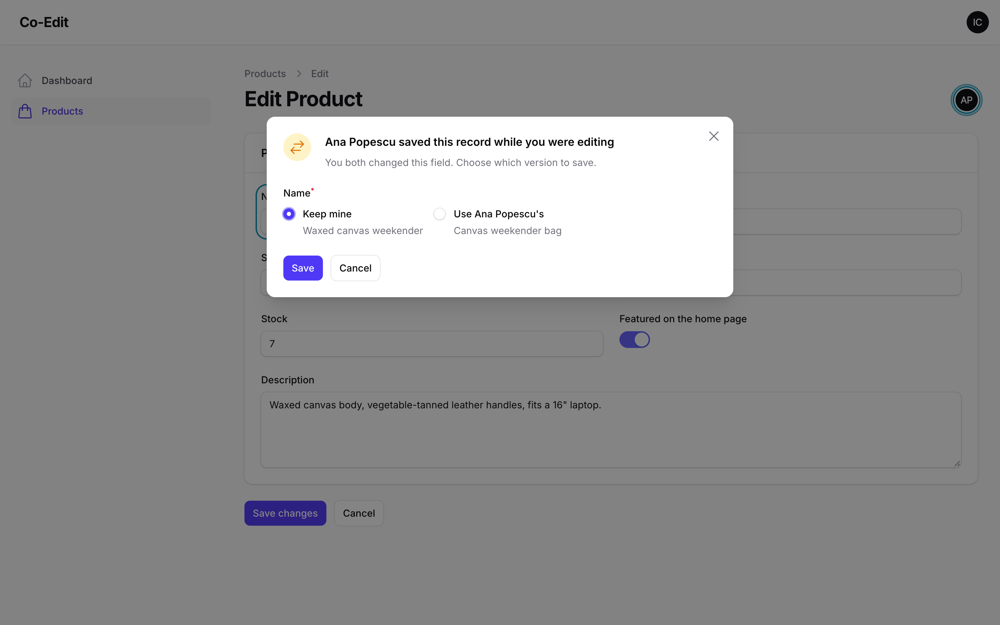

# Filament Co-Edit

<div class="filament-hidden">

[](https://packagist.org/packages/packstub/filament-coedit)
[](https://github.com/packstub/filament-coedit/actions/workflows/tests.yml)
[](https://github.com/packstub/filament-coedit/blob/main/LICENSE.md)

</div>

Several people can edit the same Filament record without locking each other out. You see who else is on the record and which field they are typing in. When you save, their changes and yours are merged field by field. Free and open source (MIT).



In Filament, the last save wins: when two people have a record open, the second save writes its whole form over the first. A record lock is one way to handle that, with one person editing while the others wait. Co-Edit merges instead, the way git merges two branches. Everyone keeps editing, and a save only asks you to choose when you and someone else changed the *same field*. Locks are a great fit when only one person should touch a record at a time. Co-Edit is for teams who would rather work on it side by side.

## Features

- **Presence in the header**: avatars of everyone else on the record, with a pulsing ring on those editing. One avatar per person, however many tabs they have open.
- **Field-level presence**: a coloured outline and a name tag on the field each person is in, so you know Ana is in Price before you start typing there.
- **Saves that merge**: if someone saved while you were editing, the fields only they changed keep their value and the fields only you changed take yours. Neither person's work is lost.
- **A conflict dialog only when needed**: when you both changed the same field, you pick *Keep mine* or *Use Ana's* for each of those fields, and only for those.
- **"Ana saved this record"**: a notice names who saved and which fields changed. **Get their changes** pulls them into your open form without saving. On a view page, **Reload** shows them.
- **Modal edits too**: `EditAction::make()->coEdit()` brings the same merge and presence to relation managers, simple (modal) resources and table edit actions.
- **Who's where in tables**: `PresenceColumn` shows avatars on the rows people have open.
- **Events for your audit log**: `ChangesMerged`, `ConflictDetected` and `ConflictResolved` say what was kept, what was contested and what each person chose.
- **Tenant-aware**: rooms include the record's database, so the same id in two tenant databases never shares presence.
- **No websockets, no migrations**: each open page checks in every few seconds with a Livewire request, and presence is kept in your cache (Redis, database, memcached…). There's no Reverb or Pusher to run and no tables to add.
- **Add a trait**: no panel plugin to register and nothing to configure.
- Dark mode, `prefers-reduced-motion`, a live region that names who is on the record for screen readers; English, Romanian, Russian and German.

## Compatibility

| Plugin | Filament | Laravel | PHP |
| --- | --- | --- | --- |
| 1.x | 4.13.3+, 5.8.3+ | 12.x, 13.x | 8.3+ |

The floors are the first Filament releases with the fixes for the multi-factor authentication advisories published up to 4.13.2 and 5.8.2. The suite runs on both floors and on the latest 4.x and 5.x.

## Installation

```bash
composer require packstub/filament-coedit
php artisan filament:assets
```

## Usage

Add the trait to an edit page:

```php
use Filament\Resources\Pages\EditRecord;
use Packstub\CoEdit\Concerns\InteractsWithCoEdit;

class EditProduct extends EditRecord
{
    use InteractsWithCoEdit;

    protected static string $resource = ProductResource::class;
}
```

That gives the page presence and the merge on save. For view pages, which only need presence, use `HasPresence`:

```php
use Packstub\CoEdit\Concerns\HasPresence;

class ViewProduct extends ViewRecord
{
    use HasPresence;
}
```

To show who's on each row, add the column. Poll the table to keep it live:

```php
use Packstub\CoEdit\Tables\PresenceColumn;

return $table
    ->poll('5s')
    ->columns([
        TextColumn::make('name'),
        PresenceColumn::make('presence'),
    ]);
```

### Modal edits

Relation managers, simple resources and any table with an `EditAction` edit records in a modal. Add `coEdit()` at the end of the chain:

```php
use Filament\Actions\EditAction;

->recordActions([
    EditAction::make()->coEdit(),
])
```

The modal gets the avatars and field markers, and its save merges. A modal has no room for a second dialog, so a conflict works in two steps: the first submit stops, and a notice shows their value for each field you both changed. Submit again to keep yours, or close the modal to keep theirs. The merge runs before the form is validated, as on an edit page, so `before()` and `after()` go anywhere in the chain. Set `afterFormFilled()`, `beforeFormValidated()` and an `action()` replacing the save before `coEdit()`, which wraps them. An `afterFormFilled()` or `beforeFormValidated()` set after replaces a part of the merge, and the save then fails loudly (in production: is reported) instead of overwriting anyone unseen; an `action()` set after still merges, but its save is not announced to the others. `coEdit(ignore: ['views'])` leaves fields out of the merge, and `coEdit(presence: false)` keeps the merge without the avatars.

### Leaving fields out

Some fields belong to someone else: a counter a job updates, or a status a webhook sets. Left out of the merge, they save as they do in plain Filament:

```php
protected function getCoEditIgnoredFields(): array
{
    return ['views'];
}
```

### Events

Listen for these to keep an audit trail or notify the person whose change was kept:

| Event | When | Payload |
| --- | --- | --- |
| `Packstub\CoEdit\Events\ChangesMerged` | A save that kept fields only the other person changed is committed | `record`, `user`, `fields`, `theirName` |
| `Packstub\CoEdit\Events\ConflictDetected` | A save found fields both changed | `record`, `user`, `fields`, `theirName` |
| `Packstub\CoEdit\Events\ConflictResolved` | The save the person chose for in the dialog is committed | `record`, `user`, `choices` (field => `mine` or `theirs`) |

### Your own save()

If your edit page overrides `save()`, the trait's version is not used. Call the merge yourself and stop when it returns `false` (the dialog is open). Wrap both in `whileSaving()` so two saves of the record never run at the same time, and call `coeditAfterSave()` once your save is done so the next merge starts from it (without it, your own save comes back as a conflict):

```php
use Packstub\CoEdit\CoEdit;

public function save(bool $shouldRedirect = true, bool $shouldSendSavedNotification = true): void
{
    CoEdit::store()->whileSaving($this->getCoEditRoom(), function (): void {
        if (! $this->coeditMergeBeforeSave()) {
            return;
        }

        // your save

        // Unless your save went through Filament's (parent::save()), which reports it:
        $this->coeditAfterSave();
    });
}
```

### Rooms

A room is one record: its database, its morph class and its key. Including the database keeps two tenants' product #5 apart in database-per-tenant apps. Tenants that share a database name, such as one Postgres schema per tenant or databases of the same name on separate servers, need the resolver below, or their people see each other on records with the same key. To decide differently, for example per team on a shared database, register a resolver in a service provider:

```php
use Packstub\CoEdit\Presence\PresenceStore;

PresenceStore::resolveRoomUsing(fn (Model $record): string => $record->team_id.':'.$record->getMorphClass().':'.$record->getKey());
```

Presence on another Filament page with a record and a header (a custom resource page) works the same way: use `HasPresence` and override `getCoEditRoom()` (keep it `protected`: a public method on a Livewire page can be called from the browser).

## How the merge works

When you save, Co-Edit reads the record again, fills it through your form and compares three versions of every field: the form as you opened it, the form as you are saving it, and the record as it is now.

| You changed it | They changed it | Result |
| --- | --- | --- |
| no | no | unchanged |
| yes | no | yours is saved |
| no | yes | theirs is kept, and you're told |
| yes, the same way | yes | saved, no question |
| yes | yes, differently | the dialog asks you |



The comparison ignores differences that only come from how forms handle values: `"12"` and `12`, `10.00` and `10`, `""`, `[]` and `null`, `true` and `"1"`, an enum and its value, a date-time with or without the `T`, the seconds or a zero fraction (one with a zone is compared in the app's time zone), and the fresh UUID keys repeaters and file uploads get on every fill. Anything else is compared exactly: `"+40123"` and `"40123"`, or two notes that start with the same date, are different values. Text is not read as a number where it can be told apart: both versions from the database compare exactly, so a version field going from `1.1` to `1.10` is their change and kept, and so does text you typed, so retyping `1.1` as `1.10` is your change. Only your `10.5` against their `10.50` is no conflict. Each form field is one unit, by its path: `meta.color` in a section with its own `statePath()` and `category.name` in a relationship group (`Group::make()->relationship()`) merge on their own, and two people changing two fields of one group never meet. A repeater, a builder, a key-value field or a JSON column a single field edits merges as a whole.

The merge only covers fields on the form. Attributes the form doesn't edit, like timestamps, counters or columns a job updates, are never written by the merge and never reported.

## Configuration

Optional. Publish it with `php artisan vendor:publish --tag=filament-coedit-config`.

| Key | Default | What it does |
| --- | --- | --- |
| `cache_store` | default store | Where presence lives, also set by `FILAMENT_COEDIT_CACHE_STORE`. Every server must share it, so in production use a shared store such as Redis or the database. |
| `heartbeat` | `4` | Seconds between heartbeats. A page also reports at once when its user moves to another field. |
| `timeout` | `20` | Seconds without a heartbeat before someone drops off. A closing tab leaves immediately. Never less than two heartbeats plus a second. |
| `idle` | `600` | Seconds without a keypress, click or pointer move before a page stops reporting in and its person drops off; the next one brings them back. Heartbeats keep the session alive, so this lets an unattended page sign out as it would without Co-Edit. `null` never pauses. |
| `track_fields` | `true` | Show which field each person is in. Off, the avatars stay and the browser never reports focus. |
| `remember_saves_for` | `3600` | Seconds that "Ana saved this record" is remembered for the people still on the record. The merge itself always compares against the database. |

## Good to know

- A heartbeat is one small Livewire request that doesn't re-render the page. With the default 4 seconds, ten people on a record send 2.5 heartbeats a second between them.
- A toggle never conflicts: it only has two values, so if they flipped it, you either left it alone (theirs is kept) or flipped it the same way.
- Relationship selects show related records by name in the dialog, even when their options are searched rather than preloaded.
- A tab in the background skips its heartbeats, so it drops off after `timeout` seconds and comes back as soon as its user switches to it. A person with the record open in another, visible tab stays on. A page nobody has touched for `idle` seconds stops too, so a forgotten tab neither keeps the session alive nor loads the server.
- After `idle` the session can expire as usual, so the first keypress or pointer move afterwards may meet Livewire's "page expired" prompt or your login page, as any request would.
- Saves of the same record run one at a time (a lock in the cache store), so two people pressing Save in the same instant are merged one after the other instead of overwriting each other. A save that waits more than 10 seconds for another one stops with a "try again" notice and writes nothing. Without a store that supports locks the saves are not serialised.
- To compare like with like, the record is filled through your page the same way it was loaded (`fillForm()`), so your `beforeFill()`/`afterFill()` hooks also run when a save merges and on **Get their changes**. The page's public properties are put back afterwards (objects as they are), so keep those hooks to setting page state; anything else they do (a query, a log line) happens on every merge. A modal's `mountUsing()` and `fillForm()` run again on each submit in the same way.
- Translatable fields (Filament's spatie-translatable plugin, `lara-zeus/spatie-translatable`) merge per locale on edit pages: the title in English and the title in Romanian are two fields, whichever locale each person has open. Ana's Romanian title stays when you save the page in English, and the dialog names the locale ("Title (RO)"). `getCoEditTranslatableAttributes()` says which attributes those are (the resource's, by default). A modal edit merges the locale it shows.
- Only Filament's own save merges. `saveFormComponentOnly()` (a field that saves its own section) writes as in plain Filament.
- If someone deletes the record while you are editing, your save never recreates it: Filament can no longer load the record and the request stops before anything is written.
- Names and avatars come from your panel (`getFilamentName()`, `getFilamentAvatarUrl()`), so people look the way they look everywhere else in the panel.

## Testing

```bash
composer test
```

The suite has 100+ tests: the merge rules and value comparison on their own, presence in the cache, and two or three people editing on real Filament edit pages and modal actions (relationships, nested and hidden fields, file uploads, a third save landing while the dialog is open, ignored fields, events, tenants, tampering from the browser). `scripts/screenshots.mjs` drives three real browsers through the whole flow and checks every step.

Try it with three people: `composer serve` starts a workbench panel on `http://127.0.0.1:8000/admin` with Products (edit pages) and Suppliers (modal edits). Log in as ion@, ana@ or mihai@example.com, password `password`, in a few private windows.

## License

MIT. See [LICENSE.md](LICENSE.md).
