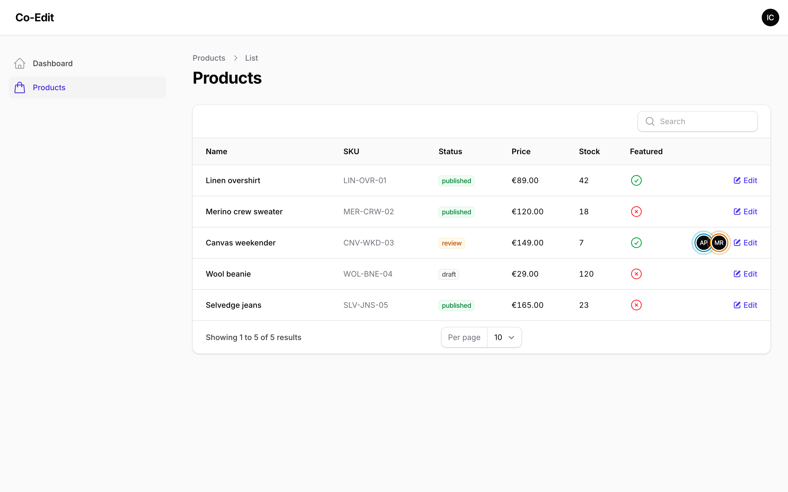
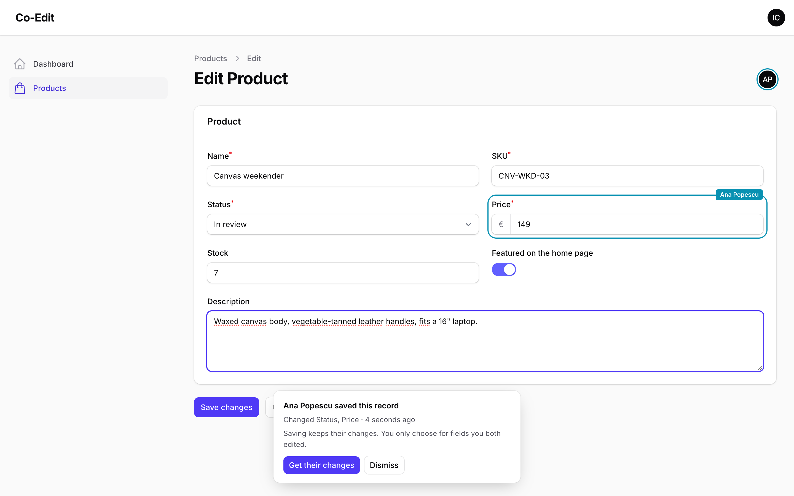
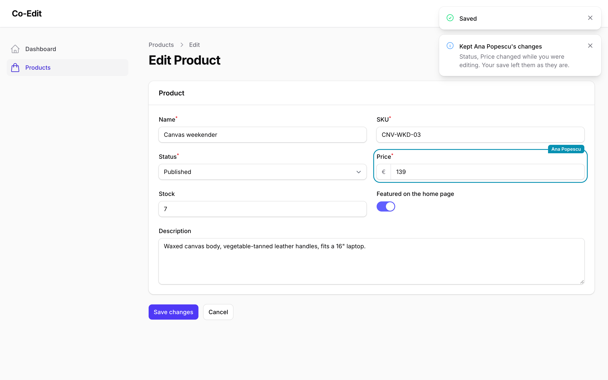

# Getting started

Add the trait to an edit page:

```php
use Filament\Resources\Pages\EditRecord;
use Packstub\CoEdit\Concerns\InteractsWithCoEdit;

class EditProduct extends EditRecord
{
    use InteractsWithCoEdit;

    protected static string $resource = ProductResource::class;
}
```

That gives the page presence and the merge on save. For view pages, which only need presence, use `HasPresence`:

```php
use Packstub\CoEdit\Concerns\HasPresence;

class ViewProduct extends ViewRecord
{
    use HasPresence;
}
```

To show who's on each row, add the column. Poll the table to keep it live:

```php
use Packstub\CoEdit\Tables\PresenceColumn;

return $table
    ->poll('5s')
    ->columns([
        TextColumn::make('name'),
        PresenceColumn::make('presence'),
    ]);
```



For relation managers, simple resources and other modal edits, see [Modal edits](modal-edits.md).

## What people see

When someone else saves while you are editing, a notice names them and the fields they changed:



**Get their changes** brings their values into your open form for every field you have not touched, without saving. **Dismiss** hides the notice. Your next save keeps their changes either way.

When you save, a notification lists the fields kept from their save:



Next: [How the merge works](how-the-merge-works.md).
