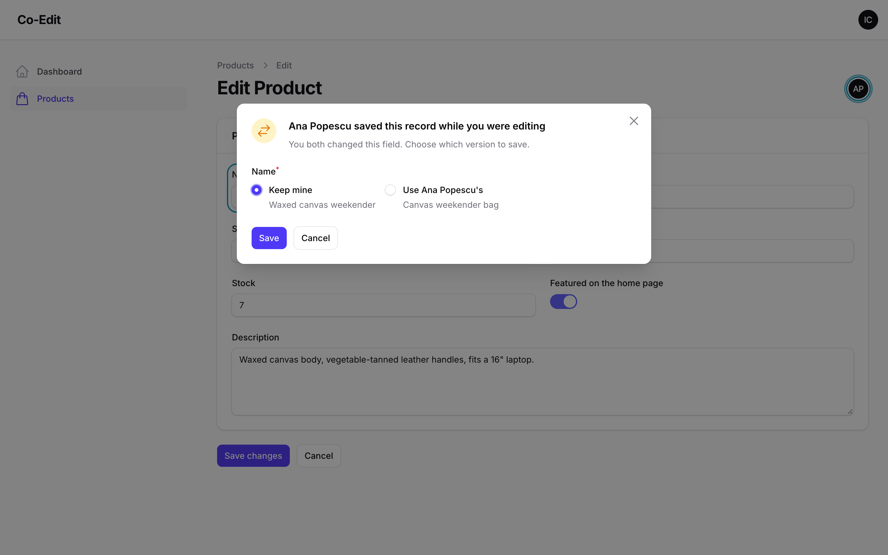

# How the merge works

When you save, Co-Edit reads the record again, fills it through your form and compares three versions of every field: the form as you opened it, the form as you are saving it, and the record as it is now.

| You changed it | They changed it | Result |
| --- | --- | --- |
| no | no | unchanged |
| yes | no | yours is saved |
| no | yes | theirs is kept, and you're told |
| yes, the same way | yes | saved, no question |
| yes | yes, differently | the dialog asks you |

The comparison ignores differences that only come from how forms handle values: `"12"` and `12`, `10.00` and `10`, `""`, `[]` and `null`, `true` and `"1"`, an enum and its value, a date-time with or without the `T` and the seconds, and the fresh UUID keys repeaters and file uploads get on every fill. Anything else is compared exactly: `"+40123"` and `"40123"`, or two notes that start with the same date, are different values. Whether someone else changed a field is decided without the number rule, because both versions come from the database: a version field going from `1.1` to `1.10` is their change, and kept. Each top-level form field is one unit. A repeater, a key-value field or a JSON column merges as a whole.

The merge only covers fields on the form. Attributes the form doesn't edit, like timestamps, counters or columns a job updates, are never written by the merge and never reported.

## Good to know

- A heartbeat is one small Livewire request that doesn't re-render the page. With the default 4 seconds, ten people on a record send 2.5 heartbeats a second between them.
- A toggle never conflicts: it only has two values, so if they flipped it, you either left it alone (theirs is kept) or flipped it the same way.
- Relationship selects show related records by name in the dialog, even when their options are searched rather than preloaded.
- A tab in the background skips its heartbeats, so it drops off after `timeout` seconds and comes back as soon as its user switches to it. A person with the record open in another, visible tab stays on. A page nobody has touched for `idle` seconds stops too, so a forgotten tab neither keeps the session alive nor loads the server.
- After `idle` the session can expire as usual, so the first keypress or pointer move afterwards may meet Livewire's "page expired" prompt or your login page, as any request would.
- Saves of the same record run one at a time (a lock in the cache store), so two people pressing Save in the same instant are merged one after the other instead of overwriting each other. A save that waits more than 10 seconds for another one stops with a "try again" notice and writes nothing. Without a store that supports locks the saves are not serialised.
- To compare like with like, the record is filled through your page the same way it was loaded (`fillForm()`), so your `beforeFill()`/`afterFill()` hooks also run when a save merges and on **Get their changes**. Only the form data is put back afterwards, so keep those hooks to setting form values.
- Translatable fields (Filament's spatie-translatable plugin) merge in the default locale: their version is filled the way the page loads, so someone editing another locale may be asked about a field against the default locale's text. Your active locale and the other locales' edits are kept.
- If someone deletes the record while you are editing, your save never recreates it: Filament can no longer load the record and the request stops before anything is written.
- Names and avatars come from your panel (`getFilamentName()`, `getFilamentAvatarUrl()`), so people look the way they look everywhere else in the panel.
