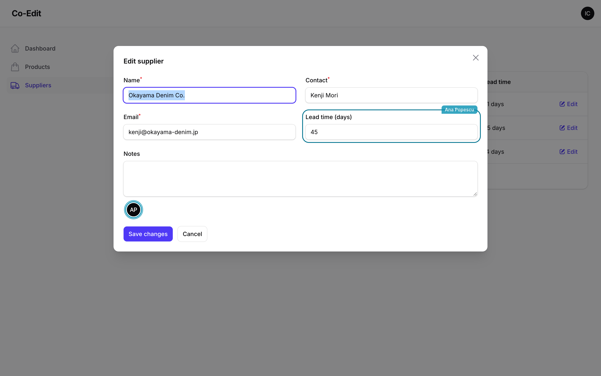

# Modal edits

Relation managers, simple resources and any table with an `EditAction` edit records in a modal. Add `coEdit()` at the end of the chain:

```php
use Filament\Actions\EditAction;

->recordActions([
    EditAction::make()->coEdit(),
])
```

The modal gets the avatars and field markers, and its save merges. A modal has no room for a second dialog, so a conflict works in two steps: the first submit stops, and a notice shows their value for each field you both changed. Submit again to keep yours, or close the modal to keep theirs. The merge runs before the form is validated, as on an edit page, so `before()` and `after()` go anywhere in the chain. Set `afterFormFilled()`, `beforeFormValidated()` and an `action()` replacing the save before `coEdit()`, which wraps them. An `afterFormFilled()` or `beforeFormValidated()` set after replaces a part of the merge, and the save then fails loudly (in production: is reported) instead of overwriting anyone unseen; an `action()` set after still merges, but its save is not announced to the others. `coEdit(ignore: ['slug'])` leaves fields out of the merge, and `coEdit(presence: false)` keeps the merge without the avatars.


